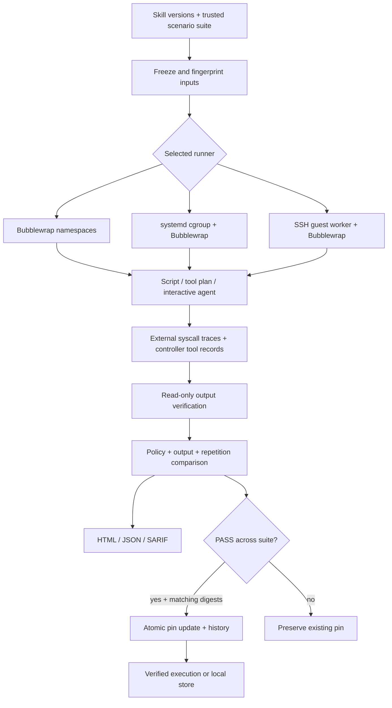

# Architecture

`config.js` validates scenarios, policies and runner options. `compare.js` coordinates isolated repetitions and evaluates findings. `sandbox.js` mounts inputs, supervises scripts/tool adapters and verifies outputs. `process.js` handles bounded process supervision and cgroup scopes. `trace.js` normalizes best-effort strace records. `vm.js` implements a bounded authenticated-transport worker protocol. `lock.js` manages local pin state and evidence provenance. `lifecycle.js` provides pin-enforced execution and content-addressed installation. `report.js` renders escaped static evidence and SARIF.

Skill content hashes include relative file names, SHA-256 contents, file lengths and an executable bit. Input symlinks and special files are rejected. Empty directories and other Unix metadata are not hashed. The trusted scenario file selects verification code; checks run read-only and cannot be replaced by the skill. Initial pins are explicit trust decisions. Reports are evidence, not signed authorizations.

Agents never receive the controller's environment or direct host execution. The interactive broker accepts only bounded argument arrays and executes each request through the selected sandbox runner. Tool records are collected by the controller; all invoked process trees are independently traced. Default network denial is unchanged for agent workflows.

Resource and coverage limits are explicit in [SECURITY.md](../SECURITY.md). There is no claim of model determinism, complete tracing, malware detection, automatic integration with other products, or zero competition.
